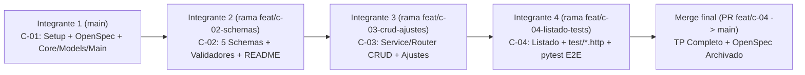
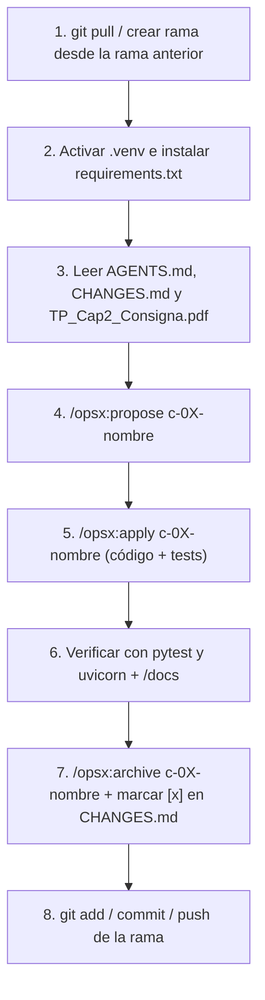

# Plan de Implementación: TP Unidad FastAPI — Los insumos de la cocina (OpenSpec)

## Objetivo General

Implementar desde cero una API REST en **FastAPI + Pydantic v2** para gestionar los insumos de una cocina (`GET`, `POST`, `PATCH`, `DELETE` y comando `POST /insumos/{id}/ajustes`), con persistencia **exclusivamente en memoria** (sin base de datos, sin autenticación y sin formato RFC 9457), cumpliendo todas las reglas de negocio (`RN-01` a `RN-12`), la estructura obligatoria de carpetas y los 16 casos de prueba mínimos (`C-01` a `C-16`) de [TP_Cap2_Consigna.pdf](TP_Cap2_Consigna.pdf).

El proyecto utilizará el flujo de trabajo **OpenSpec (`opsx`)** (`profile: core`, schema `spec-driven`: `proposal → specs → design → tasks`, gobernado por `AGENTS.md` y `CHANGES.md`), organizado en **4 etapas secuenciales encadenadas en GitHub** más una suite automática de **`pytest` + `TestClient`** junto a los archivos **`.http`** obligatorios:

1. **Integrante 1 (`main`)**: Configuración inicial, `.gitignore`, `requirements.txt` (con `fastapi[standard]` y `pytest`), OpenSpec, modelos, base en memoria y `app/main.py`.
2. **Integrante 2 (rama desde `main`)**: Los 5 schemas de Pydantic v2, validadores de contrato, `README.md` y tests unitarios de schemas con `pytest`.
3. **Integrante 3 (rama desde Integrante 2)**: Lógica de negocio y endpoints individuales (`GET /{id}`, `POST /`, `PATCH /{id}`, `POST /{id}/ajustes`, `DELETE /{id}`) + tests de endpoints en `pytest`.
4. **Integrante 4 (rama desde Integrante 3 → merge final a `main`)**: Listado paginado/filtrado/ordenable (`GET /insumos/`), archivos `.http` (`C-01` a `C-16` + defensas 2.13), suite `pytest` E2E completa y merge final a `main`.

---

## Decisiones Acordadas y Conceptos Base

> [!IMPORTANT]
> **Decisiones acordadas para el TP**
> 1. **Cantidades en `unidad == "unidad"`**: En Python/Pydantic todos los campos de cantidad mantienen el tipo `Decimal` (exigido por el Ejercicio 2: *"Las cantidades son `Decimal`, nunca `float`"*), pero cuando `unidad == "unidad"` se rechaza cualquier decimal (`valor % 1 != 0`) y se normaliza a entero sin ceros decimales (`"60"`, `"30"`, `"12"`). En `kg`, `g`, `l` y `ml` se preservan hasta 3 decimales (ej. `"25.000"`, `"2.250"`).
> 2. **Suite `pytest` además de `test/*.http`**: Los tests automáticos vivirán en `test/test_*.py` junto a `test/insumos.http` y usarán `with TestClient(app) as client:` (necesario en FastAPI para que se ejecute el `lifespan` que carga los 6 insumos iniciales en `app.state.db`).
> 3. **Paginación con filtros sin resultados (`Opción A`)**: Si un filtro deja `total = 0` (`pages = 0`), pedir `page = 1` responde **`200 OK`** con `items: []`, `total: 0`, `page: 1`, `size`, `pages: 0`. Pedir `page >= 2` cuando `total = 0`, o `page > pages` cuando `total > 0`, responde **`422`**.

> [!NOTE]
> **Introducción rápida a FastAPI para el equipo (0 experiencia previa)**
> * **¿Qué es FastAPI y Uvicorn?** FastAPI es el framework donde declaras rutas (`@router.get`, `@router.post`, etc.) y Pydantic v2 valida automáticamente los datos que llegan y salen. **Uvicorn** es el servidor ASGI que levanta la app (`uvicorn app.main:app --reload`) y genera automáticamente la pantalla interactiva de pruebas en `http://127.0.0.1:8000/docs`.
> * **Separación de capas del TP**:
>   * `models.py` / `database.py`: cómo se guardan los datos en memoria (incluye `codigo_proveedor`, no guarda `bajo_minimo`).
>   * `schemas.py`: el **contrato público** de entrada (`InsumoCreate`, `InsumoUpdate`, `AjusteCreate`) y salida (`InsumoPublic`, `Pagina`). Valida formatos antes de llegar a la lógica.
>   * `service.py`: lógica pura en Python. **No conoce HTTP** (no importa `HTTPException` ni códigos `404`/`409`). Devuelve datos, `None` o lanza excepciones propias del dominio.
>   * `router.py`: recibe el pedido HTTP con `async def`, inyecta la base con `Depends(get_db)`, llama al `service` y traduce `None` o errores propios a códigos HTTP (`404`, `409`, `422`, `201`, `204`).
> * **Entorno local**: Cada integrante trabajará dentro de su propio entorno virtual `.venv` instalando exactamente `requirements.txt` para mantener las mismas versiones en las 4 PCs.

---

## Arquitectura y Flujo de Trabajo (GitHub + OpenSpec `opsx`)

Flujo de trabajo OpenSpec adoptado:
- Perfil global OpenSpec `core`: `/opsx:explore` (opcional) → `/opsx:propose <change>` → `/opsx:apply <change>` → verificación (`pytest` / `uvicorn`) → `/opsx:archive <change>` + marcar `[x]` en `CHANGES.md`.
- Cuatro `changes` atómicos en secuencia estricta (`C-01 → C-02 → C-03 → C-04`), uno por integrante.



Ciclo interno de cada integrante:



---

## Detalle por Integrante

### Integrante 1 (`main`) — `C-01`: Setup, OpenSpec, Base en Memoria, Modelos y App

**Objetivo**: Dejar el repositorio en `main` con el proyecto inicializado, `.gitignore` configurado, `requirements.txt` listo, flujo OpenSpec configurado y la capa base + arranque de la app verificados.

#### `[NEW]` `.gitignore`, `requirements.txt`, `AGENTS.md`, `CHANGES.md`, `openspec/config.yaml`
* **`.gitignore`**:
  ```gitignore
  # Entornos y caché Python
  .venv/
  venv/
  env/
  __pycache__/
  *.py[cod]
  *$py.class
  .pytest_cache/
  .coverage
  htmlcov/

  # Variables de entorno e IDE
  .env
  .env.*
  !.env.example
  .vscode/
  .idea/
  .DS_Store
  Thumbs.db
  ```
* **`requirements.txt`**:
  ```text
  fastapi[standard]>=0.111.0
  pytest>=8.0.0
  httpx>=0.27.0
  ```
* **OpenSpec (`openspec init --tools antigravity`)**: Genera `.agents/skills/openspec-*` y `.agents/workflows/opsx-*.md`.
  * `openspec/config.yaml`: `schema: spec-driven` con `context` en español fijando las reglas del TP (Python >= 3.12, FastAPI >= 0.111, handlers `async def`, sin DB ni RFC 9457, `service.py` sin HTTP, cantidades `Decimal`).
  * `AGENTS.md`: Reglas duras del TP y protocolo de dependencias con `CHANGES.md`.
  * `CHANGES.md`: Árbol `C-01 → C-02 → C-03 → C-04` con responsabilidades y checkboxes `[ ]`.

#### `[NEW]` `app/__init__.py`, `app/core/__init__.py`, `app/modules/__init__.py`, `app/modules/insumos/__init__.py`, `test/__init__.py`
* Paquetes Python estándar para habilitar imports limpios `from app...`.

#### `[NEW]` `app/modules/insumos/models.py`
* Enumeraciones:
  * `Unidad(str, Enum)`: `kg`, `g`, `l`, `ml`, `unidad`.
  * `MotivoAjuste(str, Enum)`: `compra`, `consumo`, `merma`, `correccion`.
* Excepciones propias del dominio (para que `service.py` comunique problemas sin usar HTTP):
  * `ConflictoInsumoError(Exception)` → el router la traducirá a `409`.
  * `PaginaFueraDeRangoError(Exception)` → el router la traducirá a `422`.
* Modelo interno `Insumo` (`@dataclass`):
  * Campos: `id: int`, `nombre: str`, `unidad: Unidad`, `stock: Decimal`, `stock_minimo: Decimal`, `activo: bool`, `codigo_proveedor: str | None`, `creado_en: datetime`.
  * Propiedad calculada `@property def bajo_minimo(self) -> bool: return self.stock < self.stock_minimo` (nunca se almacena, se calcula en cada lectura).

#### `[NEW]` `app/core/database.py`
* Clase `InsumosDB` con `items: list[Insumo]` y `next_id: int`.
* Función `crear_base_inicial() -> InsumosDB` que carga los **6 insumos iniciales exactos** (`Harina 000`, `Mozzarella`, `Aceite de girasol`, `Huevos` con `Decimal("60")` y `Decimal("30")`, `Sal fina`, `Levadura seca`) con `creado_en` en UTC y `next_id = 7` (asegura no reutilizar IDs aunque se borre el 6).
* Dependencia `get_db(request: Request) -> InsumosDB` que lee `request.app.state.db`.

#### `[NEW]` `app/main.py`
* `lifespan(app: FastAPI)`: crea la base en memoria **una sola vez** al arrancar (`app.state.db = crear_base_inicial()`).
* Crea la instancia `app = FastAPI(title="Insumos de la Cocina", lifespan=lifespan)`.

#### `[NEW]` `test/test_base.py`
* Tests iniciales con `pytest` para verificar que `lifespan` inicializa exactamente 6 insumos en `app.state.db`, que `Huevos` tiene `stock == Decimal("60")`, que `Mozzarella` y `Sal fina` dan `bajo_minimo == True` (total 2), y que `next_id == 7`.

---

### Integrante 2 (rama `feat/c-02-schemas-validaciones` desde `main`) — `C-02`: Schemas Segregados, Validadores, README y Tests de Contrato

**Objetivo**: Implementar todo el contrato Pydantic v2 (`schemas.py`), la documentación obligatoria (`README.md`) y los tests unitarios de validación sin necesidad de esperar los endpoints.

#### `[NEW]` `app/modules/insumos/schemas.py`
* Tipo reutilizable `CantidadDecimal = Annotated[Decimal, Field(..., max_digits=12, decimal_places=3, ge=0)]` y helper de validación entera (`valor % 1 != 0`, normalizando a entero con `valor.quantize(Decimal("1"))` cuando `unidad == Unidad.unidad` para que viaje sin decimales como `"60"`, manteniendo el tipo `Decimal`).
* **`InsumoCreate(BaseModel)`**:
  * `model_config = ConfigDict(extra="forbid")` (`RN-06`).
  * `nombre: str = Field(..., min_length=1, max_length=80)` + `@field_validator("nombre")` que recorta bordes, reduce espacios múltiples a uno (`" ".join(v.split())`) y rechaza si queda vacío (`RN-01`).
  * `unidad: Unidad` (`RN-02`).
  * `stock: CantidadDecimal = Field(default=Decimal("0"))`.
  * `stock_minimo: CantidadDecimal = Field(default=Decimal("0"))`.
  * `activo: bool = Field(default=True)`.
  * `codigo_proveedor: str | None = Field(default=None, pattern=r"^[A-Z]{3}-\d{4}$")` (`RN-05`).
  * `@model_validator(mode="after")` (`RN-04`): si `self.unidad == Unidad.unidad`, rechazar decimales en `stock` y `stock_minimo` (`422`) y normalizar ambos a `Decimal` entero (sin `.000`).
* **`InsumoUpdate(BaseModel)`**:
  * `model_config = ConfigDict(extra="forbid")` (`RN-06`: rechaza `stock`, `unidad`, `id`, `creado_en`, `bajo_minimo`).
  * `nombre: str | None = Field(default=None, min_length=1, max_length=80)` + normalizador `RN-01` si no es `None`.
  * `stock_minimo: CantidadDecimal | None = Field(default=None)`.
  * `activo: bool | None = Field(default=None)`.
  * `codigo_proveedor: str | None = Field(default=None, pattern=r"^[A-Z]{3}-\d{4}$")`.
  * `@model_validator(mode="after")` (`RN-07`): revisa `self.model_fields_set`; si `nombre`, `stock_minimo` o `activo` llegaron explícitamente con `None` (`null`), lanza `ValueError` (`422`). `codigo_proveedor: null` sí se permite para borrarlo.
* **`AjusteCreate(BaseModel)`**:
  * `model_config = ConfigDict(extra="forbid")`.
  * `cantidad: Decimal = Field(..., max_digits=12, decimal_places=3)`.
  * `motivo: MotivoAjuste`.
  * `@model_validator(mode="after")` (`RN-08`): rechaza `cantidad == 0`; exige `cantidad > 0` para `compra`; exige `cantidad < 0` para `consumo` y `merma`; admite ambos signos (`!= 0`) para `correccion`.
* **`InsumoPublic(BaseModel)`**:
  * `model_config = ConfigDict(from_attributes=True)`.
  * Incluye `id`, `nombre`, `unidad`, `stock`, `stock_minimo`, `activo`, `bajo_minimo`, `creado_en`. **Excluye `codigo_proveedor`** (`RN-05`).
* **`Pagina(BaseModel)`**:
  * `items: list[InsumoPublic]`, `total: int`, `page: int`, `size: int`, `pages: int` (`RN-10`).

#### `[NEW]` `README.md`
* Guía rápida de instalación y ejecución (`python -m venv .venv`, `pip install -r requirements.txt`, `uvicorn app.main:app --reload`, `pytest -v`, `/docs`).
* Explicación conceptual (Objetivo 1): por qué el modelo guardado y los schemas de entrada y salida son tres piezas separadas.
* Explicación obligatoria en 2-3 oraciones (Ejercicio 3): por qué `RN-04` devuelve `422` en el alta (`InsumoCreate` conoce la `unidad` y valida el contrato) y `409` en el `PATCH` (`InsumoUpdate` no trae `unidad`, por lo que el choque contra el recurso guardado lo detecta el `service`).

#### `[NEW]` `test/test_schemas.py`
* Tests unitarios con `pytest` para validar `RN-01` a `RN-08` directamente contra los schemas (`" Queso   rallado "`, rechazo de 4 decimales sin redondeo, rechazo de `extra="forbid"`, `RN-04` en `InsumoCreate`, `null` en `InsumoUpdate`, signos en `AjusteCreate`, ocultamiento de `codigo_proveedor` en `InsumoPublic`).

---

### Integrante 3 (rama `feat/c-03-crud-y-ajustes` desde Integrante 2) — `C-03`: CRUD Individual, Comando de Ajuste y Verbos HTTP

**Objetivo**: Implementar las operaciones individuales y de mutación en `service.py` y `router.py`, conectar el router en `app/main.py` y verificar estos endpoints con `pytest` y `/docs`.

#### `[NEW]` `app/modules/insumos/service.py` *(bloque individual + ajustes)*
* Funciones puras (sin imports de `fastapi`, `HTTPException` ni códigos de estado):
  * `obtener_insumo(db: InsumosDB, insumo_id: int) -> Insumo | None`: busca por `id`; retorna `None` si no existe.
  * `crear_insumo(db: InsumosDB, datos: InsumoCreate) -> Insumo`: crea `Insumo` usando `db.next_id` (luego `db.next_id += 1`), `creado_en=datetime.now(timezone.utc)`, lo agrega a `db.items` y lo retorna.
  * `actualizar_insumo(db: InsumosDB, insumo_id: int, datos: InsumoUpdate) -> Insumo | None`: busca el insumo (`None` si falta); extrae `cambios = datos.model_dump(exclude_unset=True)`; si `insumo.unidad == Unidad.unidad` y `"stock_minimo"` viene con decimales (`% 1 != 0`), lanza `ConflictoInsumoError` (`409`); si es entero válido para `unidad`, lo normaliza a `Decimal` entero (`quantize(Decimal("1"))`); aplica solo los campos presentes (`codigo_proveedor=None` lo borra).
  * `ajustar_stock_insumo(db: InsumosDB, insumo_id: int, datos: AjusteCreate) -> Insumo | None`: busca el insumo (`None` si falta); si `insumo.unidad == Unidad.unidad` y `datos.cantidad % 1 != 0`, lanza `ConflictoInsumoError` (`409`, `RN-04`); calcula `nuevo_stock = insumo.stock + datos.cantidad`; si `nuevo_stock < 0`, lanza `ConflictoInsumoError` sin mutar nada (`409`, `RN-09`); si es `unidad`, normaliza `nuevo_stock` a `Decimal` entero (`quantize(Decimal("1"))`); actualiza `insumo.stock = nuevo_stock` y retorna el insumo.
  * `eliminar_insumo(db: InsumosDB, insumo_id: int) -> bool`: elimina de `db.items` sin tocar `db.next_id` y devuelve `True`/`False`.

#### `[NEW]` `app/modules/insumos/router.py` *(rutas individuales + ajustes)*
* `router = APIRouter(prefix="/insumos", tags=["Insumos"])` con todos los handlers `async def` recibiendo `db: InsumosDB = Depends(get_db)` y declarando `response_model`:
  * `@router.get("/{insumo_id}", response_model=InsumoPublic)` → `404` si `None`.
  * `@router.post("/", response_model=InsumoPublic, status_code=status.HTTP_201_CREATED)` → setea `response.headers["Location"] = f"/insumos/{creado.id}"`.
  * `@router.patch("/{insumo_id}", response_model=InsumoPublic)` → `404` si `None`, `409` ante `ConflictoInsumoError`.
  * `@router.post("/{insumo_id}/ajustes", response_model=InsumoPublic)` → responde `200`, `404` si `None`, `409` ante `ConflictoInsumoError`.
  * `@router.delete("/{insumo_id}", status_code=status.HTTP_204_NO_CONTENT)` → devuelve `Response(status_code=204)` sin cuerpo o `404`.

#### `[MODIFY]` `app/main.py`
* Importar `router as insumos_router` desde `app.modules.insumos.router` y registrarlo con `app.include_router(insumos_router)`.

#### `[NEW]` `test/test_crud_ajustes.py`
* Tests con `pytest` y `with TestClient(app) as client:` cubriendo casos `C-01` a `C-12` y `C-16` (detalle, alta con `Location` y normalización, multi-error `C-06`, `PATCH` parcial y `null`, ajuste `200`/`409` sin mutar, ajuste decimal sobre `Huevos` → `409`, `DELETE` doble y no reutilización de ID `6`).

---

### Integrante 4 (rama `feat/c-04-listado-y-pruebas` desde Integrante 3 → Merge final a `main`) — `C-04`: Listado, Suite `.http` y Verificación E2E

**Objetivo**: Completar el listado paginado/filtrable/ordenable (`GET /insumos/`), entregar la batería completa `test/*.http` (`C-01` a `C-16` + Ejercicio 8), agregar el test secuencial E2E en `pytest` y mergear la rama final en `main`.

#### `[MODIFY]` `app/modules/insumos/service.py` *(agregar listado)*
* `listar_insumos(db: InsumosDB, *, page: int, size: int, sort: str | None, unidad: Unidad | None, bajo_minimo: bool | None, activo: bool | None) -> dict`:
  * Aplicar filtros (`unidad`, `bajo_minimo`, `activo`) **antes** de contar (`RN-11`).
  * `total = len(filtrados)`, `pages = math.ceil(total / size) if total > 0 else 0`.
  * Validar rango de página (`RN-10`, Opción A): si `(total == 0 and page > 1)` o `(total > 0 and page > pages)` → lanzar `PaginaFueraDeRangoError` (`422`); con `total == 0` y `page == 1`, devolver `items=[]`, `total=0`, `pages=0` (`200 OK`).
  * Ordenamiento contra lista blanca (`RN-12`): si `sort` está presente, determinar `desc = sort.startswith("-")` y campo `sort.lstrip("-")` (`nombre`, `stock`, `creado_en`), comparando strings en minúsculas para `nombre` (o orden lexicográfico estándar), `Decimal` para `stock` y `datetime` para `creado_en`.
  * Recortar slice `[start : start + size]` y devolver estructura compatible con `Pagina`.

#### `[MODIFY]` `app/modules/insumos/router.py` *(agregar `GET /insumos/`)*
* `@router.get("/", response_model=Pagina)` con:
  * `page: int = Query(default=1, ge=1)`
  * `size: int = Query(default=20, ge=1, le=100)`
  * `sort: str | None = Query(default=None, pattern=r"^-?(nombre|stock|creado_en)$")` (`422` automático si se pasa `?sort=codigo_proveedor`).
  * `unidad: Unidad | None = Query(default=None)` (`422` automático si llega valor fuera de `Unidad`).
  * `bajo_minimo: bool | None = Query(default=None)`
  * `activo: bool | None = Query(default=None)`
  * Captura `PaginaFueraDeRangoError` → `HTTPException(status_code=422, detail=...)`.

#### `[NEW]` `test/insumos.http`
* Archivo `.http` secuencial para ejecutarse **con el servidor recién arrancado** (estado semilla de 6 insumos), con cada caso en orden exacto `C-01` a `C-16` y comentario de respuesta esperada arriba de cada petición, más casos extra del Ejercicio 8 (defensas 2.13):
  * `C-01` a `C-16` completos en orden exacto (pág. 8-9 de la consigna).
  * Casos extra de defensas 2.13: verificar que `codigo_proveedor` no salga en listado ni detalle, que campos extra fallen con `422` y que `?sort=codigo_proveedor` / `?unidad=docena` fallen con `422`.

#### `[NEW]` `test/test_listado_y_flujo_e2e.py`
* Suite `pytest` completa que levanta una app limpia (`with TestClient(app) as client:`) y ejecuta **en orden exacto de principio a fin** la secuencia completa `C-01` → `C-16`, validando además filtros combinados (`?unidad=kg&sort=-stock`), orden descendente y `RN-10`/`RN-11`/`RN-12`.

---

## Plan de Verificación

### Pruebas Automatizadas
En cada etapa (y tras el merge final en `main`):
1. **Validación de OpenSpec**:
   ```powershell
   openspec validate <nombre-change>
   openspec list --specs
   ```
2. **Suite completa `pytest`**:
   ```powershell
   pytest -v
   ```
   Verifica automáticamente modelos, schemas (`RN-01` a `RN-08`), CRUD + ajustes (`RN-09`), listado (`RN-10` a `RN-12`) y la secuencia íntegra `C-01` a `C-16` desde estado inicial limpio.

### Verificación Manual
1. **Arranque del servidor y OpenAPI (`/docs`)**:
   ```powershell
   uvicorn app.main:app --reload
   ```
   * Confirmar en `http://127.0.0.1:8000/docs` que aparecen los 6 endpoints publicados (sin `PUT`), con sus `response_model` y sin `codigo_proveedor` en las respuestas.
2. **Ejecución secuencial de `test/insumos.http`**:
   * Reiniciar `uvicorn app.main:app` para volver al estado semilla de 6 insumos.
   * Correr los requests `C-01` a `C-16` de `test/insumos.http` en orden estricto (con la extensión REST Client de VS Code) y corroborar que todos coincidan con los códigos de estado, encabezado `Location` y JSON esperados.
3. **Verificación final en `main`**:
   * Tras el merge de `feat/c-04-listado-y-pruebas` → `main`, comprobar con `git status` / listado de repo remoto que `.venv/` y `__pycache__/` quedaron excluidos gracias a `.gitignore` y que la estructura obligatoria + `openspec/` quedaron íntegros.
